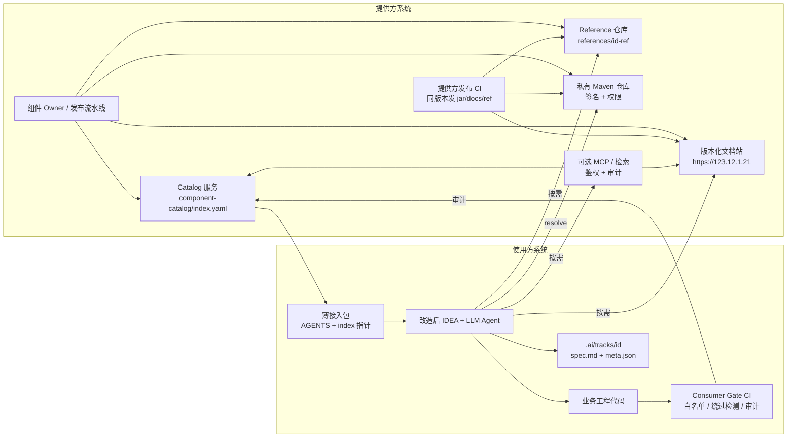

# 胶水编程最终版设计（Cursor 交接稿）

| 字段 | 值 |
|------|-----|
| 标题 | 胶水编程最终版设计（供 Cursor 展开详细开发设计） |
| 状态 | **Final for handoff** |
| 受众 | Cursor / 同类编码 Agent（非管理层） |
| 语言 | 中文 |
| 日期 | 2026-10-12（Asia/Shanghai） |
| 用途 | 单一事实源（SSOT）：固化实现决策，供后续生成模块/API/Schema/任务清单，无需再问产品意图 |
| 上游 | `/workspace/胶水编程实现方案-领导汇报.md`（口径对齐；本文不重复汇报叙事） |

---

## 1. Document meta

### 1.1 Owners（提供方）

| 角色 | 职责 |
|------|------|
| 组件 Owner | 每个高频 Maven 组件的 GAV、CHANGELOG、兼容策略、废弃公告 |
| 样板 Owner | `references/<id>-ref` 与组件同版本发布；`mvn test` 绿 |
| 目录 Owner | `component-catalog/index.yaml` 与分类、标签、文档基址 |
| 规范 Owner | 共享 `AGENTS.md` 模板、constitution 片段、门禁规则 |
| 平台 Owner | 私有 Maven 鉴权、签名、可选 MCP、IDEA init / CLI |

### 1.2 Consumers（使用方）

| 角色 | 环境 | 职责 |
|------|------|------|
| 业务开发 | 改造后的 IDEA + LLM Agent | 写任务规格；按物料拼装；不绕过内部组件 |
| Consumer CI | Gate 流水线 | pom 白名单、绕过检测、审计日志 |
| Consumer 工程 | 薄接入包已 init | 只保留入口与指针，不拷整站文档 |

### 1.3 交接约定

Cursor 读完本文后，应能直接声明：`我将为 workstream N 撰写详细设计`，且不得重新发明核心概念或交付形态。

---

## 2. Goals / Non-goals

### 2.1 Goals（必须达成）

| ID | Goal |
|----|------|
| G1 | 使用方 Agent 出码时，优先命中内部 Maven 组件，产出最小胶水代码 |
| G2 | 规格与物料分离：意图可审，执行可复用 |
| G3 | 交付形态为「Maven 制品 + 版本化文档 + 薄接入包 + 可选 MCP」，可签名、可审计 |
| G4 | 样板与文档与 jar **同版本发布**，杜绝漂移 |
| G5 | 门禁阻断「未知坐标 / 手写已有能力 / 绕过内部组件」 |
| G6 | Track 记录决策；规格变更手动同步、可审计 |
| G7 | 规模从 5 → 50 → 100 组件时，永不「全量加载文档进上下文」 |

### 2.2 Non-goals（明确不做）

| ID | Non-goal |
|----|----------|
| NG1 | 不替使用方写业务代码 |
| NG2 | 不把整站文档工程打进使用方仓库（默认路径禁止） |
| NG3 | 不把一次性拷贝过期文档当作长期真相源 |
| NG4 | 不静默自动改写 Track / spec（同步须手动触发） |
| NG5 | 不做匿名可拉的内部制品或文档 |
| NG6 | 本期不强制建设 MCP；未建前以「版本化文档 + index 指针」过渡，安全底线不降 |
| NG7 | 离线包仅为极端备选，**非默认** |

---

## 3. Core concepts（精确定义）

### 3.1 规格管意图

**规格（SPEC）**：描述「要做成什么」。

必含字段（任务级）：

- `goal`：目标一句话
- `scope` / `out_of_scope`
- `constraints`：技术与合规约束
- `acceptance`：可验证验收条件
- `exceptions`：豁免与理由（须 Track 记录）

Agent 规则：**未对齐规格不得改业务代码**。

### 3.2 物料管执行

**物料**：描述「用什么做成」。Agent 只能在受控物料内拼装。

### 3.3 四层物料

| 层 | 名称 | 落点 | Agent 用途 |
|----|------|------|------------|
| L1 | 开发规范 | `AGENTS.md`、`.ai/constitution.md`（或片段） | 红线、禁用模式、必须走内部组件 |
| L2 | 代码模式 / 样板 | `references/<componentId>-ref/` | 依赖声明、配置、调用链、测试骨架；「能抄」 |
| L3 | 领域知识 / 组件文档 | 版本化文档站 `/{artifactId}/{version}/` | 按坐标+版本检索 API/FAQ/错误码 |
| L4 | 任务规格 | `.ai/tracks/<trackId>/spec.md` | 单次需求意图；变更后同步 |

### 3.4 能抄不写

优先级（硬顺序）：

1. 从 reference 模块拷贝 / 改编胶水代码  
2. 引入内部 Maven GAV 并调用公开 API  
3. 仅写无法由组件覆盖的最小胶水  

禁止默认路径：Agent 另起炉灶实现已有组件能力；门禁须可检测。

### 3.5 Track / 规格保鲜

| 术语 | 定义 |
|------|------|
| Track | 一次需求的决策轨迹：选了哪些组件/版本、为何、有无豁免 |
| 规格保鲜 | 规格或组件大版本变更后，Track 内 `spec.md` 与 `meta.json` 必须同步 |
| 触发方式 | **手动触发** sync skill；禁止静默自动改写 |
| 审计 | 每次同步写审计记录（操作者、时间、前后摘要） |

### 3.6 常驻 vs 按需加载

| 类型 | 定义 | 示例 |
|------|------|------|
| 常驻（always-on） | 工程 init 后始终在 Agent 上下文入口中 | `AGENTS.md`、constitution 片段、`index.yaml` 摘要指针 |
| 按需（on-demand） | 匹配到组件后再拉取 | 该组件版本文档页、reference 模块源码、FAQ |

规则：**永不**把全量组件文档塞进上下文。

---

## 4. Actors & system context



边界：

- 提供方：制品、文档、样板、目录、可选 MCP、发布同版本门禁  
- 使用方：薄包接入、按规格出码、Consumer Gate、Track 保鲜  
- 可选 MCP：未建设时用 DocSite + Catalog 指针，不降低鉴权要求  

---

## 5. End-to-end runtime flow（编号，panda-test 示例）

**示例组件**：`panda-test`  
**文档基址**：`https://123.12.1.21`  
**版本路径约定**：`https://123.12.1.21/{artifactId}/{version}/`  
例：`https://123.12.1.21/panda-test/1.2.0/`

| 步 | 动作 | 输入 | 输出 / 断言 |
|----|------|------|-------------|
| 1 | **init** | 使用方仓库执行 IDEA 插件或 `glue-init` CLI | 写入 `AGENTS.md`、constitution 片段、`component-catalog/index.yaml`（或远程指针 + 校验和）、文档基址配置 |
| 2 | **读 AGENTS + index** | Agent 启动 / 任务开始 | 加载 L1 常驻规则；加载 catalog 索引（仅元数据，不含全文文档） |
| 3 | **匹配组件** | 任务规格关键词 / 能力标签（如 `panda`、`测试夹具`） | 命中 `componentId: panda-test`，得到 GAV、`docsBase`、`referenceModule`、`version` |
| 4 | **fetch docs（按需）** | `GET https://123.12.1.21/panda-test/1.2.0/`（鉴权） | 拉取该版本 API/FAQ/错误码；禁止拉取其他版本或全站 |
| 5 | **fetch reference（按需）** | 打开 `references/panda-test-ref`（本地 submodule / 稀疏检出 / 坐标指向的样板仓） | 得到可运行样板：pom、调用示例、测试 |
| 6 | **edit consumer code** | 对照规格 + 样板 | 业务仓引入 `groupId:artifactId:1.2.0`；只写胶水；更新 Track |
| 7 | **gates** | PR / 本地 pre-commit | pom 白名单通过；绕过检测通过；审计事件写入；失败则阻断合入 |

失败处理：

- init 签名/校验和失败 → **中止**，不写入半套文件  
- 文档 401/403 → Agent 停止猜 API，提示鉴权  
- 样板 `mvn test` 非绿 → 禁止将该版本标为「可抄」  
- Gate 失败 → 不得 merge  

---

## 6. Delivery artifacts（精确清单）

### 6.1 Shared once（全库共享，提供方维护）

| 产物 | 路径 / 形态 | 说明 |
|------|-------------|------|
| AGENTS 模板 | `templates/AGENTS.md` | 使用方 init 时渲染 |
| constitution 片段 | `templates/constitution.snippet.md` | 红线规则，可合并进 `.ai/constitution.md` |
| Catalog 索引 Schema | `component-catalog/index.schema.json` + `index.yaml` | 见第 7 节 |
| IDEA 插件或 init CLI | `tools/glue-init` 或 IDEA plugin | 行为见下表 |
| 私有仓鉴权模型 | 文档 + 配置模板 | 短期 token、按团队/CI 最小权限；禁止匿名 |
| 可选 MCP | `mcp/glue-docs` | 工具：`search_component`、`get_docs_page`、`get_gav`；鉴权+审计 |

**IDEA 插件 / init CLI 必做行为**：

1. 校验薄包签名或 checksum  
2. 写入/更新 `AGENTS.md`、constitution 片段  
3. 写入 catalog 指针（本地 yaml 或远程 URL + pin 版本 + checksum）  
4. 写入文档基址（默认 `https://123.12.1.21`）与鉴权方式占位  
5. 失败即回滚，不留半成品  

### 6.2 Per component（每个组件）

| 产物 | 约定 |
|------|------|
| Maven GAV | `groupId` / `artifactId` / `version`；发布至私有仓；签名或仓库完整性校验 |
| 版本化文档 | `https://123.12.1.21/{artifactId}/{version}/`；与 jar 同发 |
| Reference 模块 | `references/{componentId}-ref/`；内容见第 9 节 |
| Catalog 条目 | `index.yaml` 中一条完整记录 |
| CHANGELOG | 机读，与 version 一一对应 |
| 废弃公告 | 若适用：截止日期、迁移目标 GAV、替代 API |

---

## 7. index.yaml schema

### 7.1 顶层字段

```yaml
# component-catalog/index.yaml
schemaVersion: "1.0"          # 必填；catalog schema 版本
updatedAt: "2026-10-12T03:00:00Z"  # 必填；ISO8601
docsDefaultBase: "https://123.12.1.21"  # 必填；文档默认基址
components: []                # 必填；组件数组
```

### 7.2 `components[]` 字段（完整列表）

| 字段 | 类型 | 必填 | 说明 |
|------|------|------|------|
| `id` | string | Y | 稳定 ID，kebab-case，如 `panda-test` |
| `name` | string | Y | 展示名 |
| `description` | string | Y | 一句话能力说明（供匹配） |
| `category` | string | Y | 一级分类，如 `testing` / `messaging` / `storage` |
| `tags` | string[] | Y | 检索标签，小写 |
| `gav.groupId` | string | Y | Maven groupId |
| `gav.artifactId` | string | Y | 须与文档路径 `{artifactId}` 一致 |
| `gav.version` | string | Y | 当前推荐版本（semver） |
| `gav.versionsSupported` | string[] | N | 仍支持的版本列表 |
| `docs.base` | string | N | 覆盖默认基址；缺省用 `docsDefaultBase` |
| `docs.pathTemplate` | string | Y | 默认 `"/{artifactId}/{version}/"` |
| `docs.url` | string | Y | 解析后的推荐版本文档 URL |
| `reference.module` | string | Y | 如 `references/panda-test-ref` |
| `reference.repo` | string | N | 样板所在 git URL（若非单体仓） |
| `reference.ref` | string | N | git tag/commit；建议与 version 对齐 tag |
| `owner.team` | string | Y | 维护团队 |
| `owner.contact` | string | Y | 联系人/邮箱/群 |
| `status` | enum | Y | `active` \| `deprecated` \| `experimental` |
| `deprecated` | object | N | `status=deprecated` 时必填：`sunset`、`migrateTo`、`note` |
| `capabilities` | string[] | Y | 能力关键字，供 Agent 匹配 |
| `constraints` | string[] | N | 使用约束（JDK、框架版本等） |
| `checksum` | string | N | 本条目相关薄包/索引片段校验（若拆分发布） |

### 7.3 panda-test 填好的示例

```yaml
schemaVersion: "1.0"
updatedAt: "2026-10-12T03:00:00Z"
docsDefaultBase: "https://123.12.1.21"
components:
  - id: panda-test
    name: Panda Test
    description: 内部测试夹具与断言辅助组件，供业务测试胶水复用
    category: testing
    tags:
      - panda
      - test
      - fixture
      - assert
    gav:
      groupId: com.example.internal
      artifactId: panda-test
      version: "1.2.0"
      versionsSupported:
        - "1.2.0"
        - "1.1.4"
    docs:
      pathTemplate: "/{artifactId}/{version}/"
      url: "https://123.12.1.21/panda-test/1.2.0/"
    reference:
      module: references/panda-test-ref
      repo: git@git.example.internal:glue/references.git
      ref: "panda-test-1.2.0"
    owner:
      team: platform-components
      contact: components-owners@example.internal
    status: active
    capabilities:
      - test-fixture
      - fluent-assert
      - mock-helper
    constraints:
      - "JDK >= 17"
      - "JUnit 5"
```

### 7.4 匹配算法（实现约束，供详细设计展开）

1. 用任务规格文本对 `tags` + `capabilities` + `description` 做检索（keyword 优先，可加语义）  
2. 过滤 `status != deprecated`（除非规格显式要求旧版）  
3. 取推荐 `gav.version`；文档 URL 按 `docsDefaultBase + pathTemplate` 解析  
4. 一次任务默认只深拉 **命中的 N≤3** 个组件文档与 reference  

---

## 8. AGENTS.md / constitution 必含规则

Cursor 可将下列条目直接变成模板段落。

### 8.1 AGENTS.md must-include

- 先读任务规格（`.ai/tracks/<id>/spec.md`），未对齐不改业务代码  
- 先读 `component-catalog/index.yaml`，按能力匹配内部组件  
- 命中后：按需拉取**该版本**文档与 reference；禁止全量文档进上下文  
- 出码顺序：抄 reference → 引 GAV → 写最小胶水  
- 禁止手写已在 catalog 中的能力（除非 Track 记录豁免）  
- 依赖坐标必须来自白名单 / catalog 推荐 GAV  
- 文档基址仅使用配置的 `docsDefaultBase`（例：`https://123.12.1.21`）  
- 变更组件版本时，更新 Track `meta.json` 并触发规格保鲜检查  
- 不得把密钥、长期 token、未授权内网细节写入可提交文件  
- Gate 失败时停止并修复，不得建议 bypass  

### 8.2 constitution must-include（红线）

- 内部可复用能力必须走私有 Maven 坐标，禁止粘贴内部源码进业务仓  
- 禁止引入未在白名单的 groupId  
- 禁止为绕过门禁而改名包装、反射调用禁用以 API、复制实现  
- 文档与样板必须以版本对齐；禁止依赖「无版本」口头记忆  
- 离线文档包非默认；启用须在 Track 标明版本、生成时间、失效条件  
- 规格同步必须手动确认；禁止 Agent 静默改写 acceptance  
- 废弃组件不得用于新代码（`status=deprecated`）  

---

## 9. Reference 模块标准布局与验收

### 9.1 路径与命名

```
references/
  panda-test-ref/
    pom.xml
    README.md
    src/main/java/...
    src/test/java/...
    src/main/resources/application-ref.example.yml   # 若需要配置则必有
    .glue-ref-meta.yaml                              # 绑定 componentId + version
```

### 9.2 `.glue-ref-meta.yaml` 必填

```yaml
componentId: panda-test
gav:
  groupId: com.example.internal
  artifactId: panda-test
  version: "1.2.0"
docsUrl: "https://123.12.1.21/panda-test/1.2.0/"
owner: platform-components
```

### 9.3 必含文件

| 文件 | 要求 |
|------|------|
| `pom.xml` | 声明目标 GAV；可独立构建 |
| `README.md` | 场景、如何运行测试、与文档 URL 链接 |
| 最少 1 个 main 调用示例 | 展示标准调用链 |
| 最少 1 个测试类 | 覆盖主路径；断言可读 |
| `.glue-ref-meta.yaml` | 与 catalog 条目一致 |

### 9.4 验收标准（硬）

| 检查项 | 标准 |
|--------|------|
| `mvn test` | 退出码 0 |
| 耗时 | **< 10 分钟**（含依赖下载的冷/热策略在详细设计中定；CI 须记录时长） |
| 版本对齐 | meta.version == 已发布 jar version == 文档 path version |
| 无密钥 | 扫描不含 token/密码 |
| 可抄 | README 写明「复制哪些类/配置到业务仓」 |

---

## 10. Loading policy table

| 资产 | 策略 | 何时进入 Agent 上下文 | 禁止事项 |
|------|------|------------------------|----------|
| `AGENTS.md` | 常驻 | init 后始终 | 塞入组件全文 |
| constitution 片段 | 常驻 | init 后始终 | 同上 |
| `index.yaml` 元数据 | 常驻（可摘要） | 任务开始 | 把每个组件的文档正文内联进 index |
| 命中组件文档页 | 按需 | 匹配到 id 之后 | 拉取全站或其他版本 |
| reference 源码 | 按需 | 决定抄样板时 | 一次加载全部 `references/*` |
| MCP 检索结果 | 按需 | 显式 tool call | 无鉴权调用 |
| Track `spec.md` | 任务常驻 | 当前 track 打开时 | 同时打开无关历史 track 全文 |
| 离线文档包 | 备选 | 仅 Track 声明启用时 | 当作默认真相源 |
| CHANGELOG | 按需 | 升级版本决策时 | 全组件 changelog 一次性灌入 |

---

## 11. Scale 5 → 50 → 100

| 规模 | Catalog | 加载 | 版本流水线 |
|------|---------|------|------------|
| **5** | 单文件 `index.yaml`；扁平 tags | 命中后拉 1 个组件 docs+ref | 手工同发 jar/docs/ref；CI 校验 meta 对齐 |
| **50** | 强制 `category`；index 可按 category 拆文件再合并校验 | Agent 只加载 category 摘要 + 命中详情；N≤3 | 发布流水线强制：同一 version tag 产出三件套；失败阻断 |
| **100** | Catalog 服务化（API）；搜索 + 权限过滤；deprecated 自动降权 | **永不**全量 docs；分页检索；本地仅 pin 的 checksum 索引 | 多 Owner；废弃窗口自动化公告；兼容矩阵机读 |

不变式：

- 上下文只含常驻 L1 + 当前任务 L4 + 少量按需 L2/L3  
- `index.yaml`（或 API）是发现面，不是文档正文仓库  

---

## 12. Security & long-term stability

### 12.1 安全（必须）

| 控制项 | 要求 |
|--------|------|
| 私有 Maven 鉴权 | 仅团队/CI 身份；禁止匿名读内部制品 |
| Token | 短期、最小 scope；禁止长期个人 token 进共享配置与样板 |
| 文档站鉴权 | `https://123.12.1.21` 须登录或服务身份；按项目授权 |
| MCP 鉴权与审计 | 若启用：每个 tool call 记 who/what/when/componentId/version |
| 签名 / 完整性 | jar 签名或仓库侧校验；薄包 checksum；init 失败则中止 |
| 密钥隔离 | 样板与文档不得含生产密钥；示例用占位符 |
| 依赖白名单 | 见第 13 节 Gate |

### 12.2 长期稳定（必须）

| 机制 | 要求 |
|------|------|
| Semver | MAJOR 破坏兼容；MINOR 增功能；PATCH 修复 |
| CHANGELOG | 每版本必更新，机读字段至少：`version`、`date`、`breaking`、`migration` |
| 同版本三件套 | jar + docs + reference 同一 version；缺一不可标 `active` 推荐 |
| 废弃 | `status=deprecated` + `sunset` + `migrateTo`；新代码门禁拒绝 |
| 支持窗口 | 明确 N 与 N-1；写进 catalog `versionsSupported` |
| 离线 fallback | 非默认；须 pin 版本+checksum+失效时间；恢复在线后切回指针 |

---

## 13. Gates

### 13.1 pom whitelist

| 规则 | 行为 |
|------|------|
| 允许 | catalog 中 `active`/`experimental` 的 GAV；组织级白名单 groupId |
| 拒绝 | 未知 groupId/artifactId；已 deprecated 且用于新增依赖 |
| 输出 | PR check 失败信息含「建议 GAV / 文档 URL」 |

### 13.2 bypass detection（绕过检测）

检测信号（详细设计可扩展规则包）：

- 大段疑似内部组件实现的粘贴（哈希/指纹库，可选）  
- 禁止包名 / 禁止 API 的重新封装  
- 配置开关关闭门禁、`skip*Gate` 类标记  
- 业务仓出现整站文档镜像目录（体积/路径启发式）  

命中 → **阻断**（除非 Track 豁免且经人工批准标签）。

### 13.3 audit

每条审计事件至少：

```json
{
  "ts": "2026-10-12T03:15:00+08:00",
  "actor": "ci:pr-123|user:alice",
  "action": "gate.pom_whitelist|gate.bypass|docs.fetch|mcp.call|track.sync",
  "componentId": "panda-test",
  "version": "1.2.0",
  "result": "allow|deny",
  "detail": "free text or structured reason"
}
```

保留周期与存储位置：TBD（见第 16 节），但实现必须先打点。

---

## 14. Track / spec freshness

### 14.1 目录布局

```
.ai/
  tracks/
    <trackId>/
      spec.md          # 任务规格（意图）
      meta.json        # 组件选择、版本、豁免、同步状态
      audit.log        # 可选；或写到中央审计
  constitution.md      # 常驻红线（由片段合并）
```

### 14.2 `meta.json` 最小 schema

```json
{
  "trackId": "2026-10-12-panda-integrate",
  "title": "接入 panda-test 做订单单测胶水",
  "status": "active",
  "createdAt": "2026-10-12T10:00:00+08:00",
  "updatedAt": "2026-10-12T11:00:00+08:00",
  "components": [
    {
      "componentId": "panda-test",
      "version": "1.2.0",
      "docsUrl": "https://123.12.1.21/panda-test/1.2.0/",
      "referenceModule": "references/panda-test-ref"
    }
  ],
  "exceptions": [],
  "specHash": "sha256:...",
  "lastSyncAt": "2026-10-12T11:00:00+08:00",
  "lastSyncBy": "alice"
}
```

### 14.3 sync skill（手动触发）

| 项 | 约定 |
|----|------|
| 名称 | `track-sync`（skill / 命令） |
| 触发 | 人显式执行；Agent 可建议但不得自动改写 |
| 行为 | 对比 catalog 当前推荐版本 vs `meta.json`；对比 `spec.md` 与实现；生成 diff 摘要；人工确认后写回 |
| 审计 | 写 `action=track.sync` |
| 失败 | 版本漂移未确认 → Track 标 `stale`；Gate 可警告或阻断（策略 TBD） |

---

## 15. Workstreams for next detailed design

Cursor 下一步应分别产出「详细开发设计」文档。每条均可独立开写。

### ① Catalog & index service

| 项 | 内容 |
|----|------|
| Goal | 定义 `index.yaml` 校验、合并、（50+）服务化 API、匹配算法、权限过滤 |
| 交付物草案 | Schema JSON、校验 CLI、检索 API OpenAPI、分类规范 |
| Open questions | 单文件 vs 拆分 category 文件的切换阈值？检索用纯 keyword 还是混合语义？Catalog 写权限模型？ |

### ② IDEA init plugin

| 项 | 内容 |
|----|------|
| Goal | 一键薄包接入：签名校验、写入 AGENTS/constitution/index 指针/文档基址 |
| 交付物草案 | 插件用例、CLI 参数、失败回滚、IDEA 版本矩阵 |
| Open questions | 只做 CLI 还是 IDEA+CLI 双端？薄包发布介质（Maven classifier / git release asset）？ |

### ③ Docs versioning & MCP

| 项 | 内容 |
|----|------|
| Goal | 固定 `https://123.12.1.21/{artifactId}/{version}/` 发布契约；可选 MCP 工具与鉴权审计 |
| 交付物草案 | 文档发布 pipeline、URL 约定测试、MCP tool schema |
| Open questions | 本期是否上 MCP？文档站 SSO 方案？页面 HTML vs 机读 Markdown 双轨？ |

### ④ Reference module skeleton & CI

| 项 | 内容 |
|----|------|
| Goal | `references/<id>-ref` 骨架生成器；CI 保证 `<10 min` 绿测与版本对齐 |
| 交付物草案 | archetype/模板、CI workflow、时长基线、meta 校验 |
| Open questions | 样板单体仓还是每组件仓？依赖下载缓存策略如何计入 10 分钟？ |

### ⑤ Consumer gates

| 项 | 内容 |
|----|------|
| Goal | pom 白名单、绕过检测、审计事件；PR 阻断 |
| 交付物草案 | 规则包、CI job、豁免流程、审计 schema |
| Open questions | 绕过检测第一期用规则还是指纹库？`stale` Track 是 warn 还是 block？ |

### ⑥ Track sync skill

| 项 | 内容 |
|----|------|
| Goal | `.ai/tracks/<id>/` 布局、`meta.json`、手动 sync skill、审计 |
| 交付物草案 | skill 说明、命令 UX、stale 状态机 |
| Open questions | Track 与现有 SDD 目录如何映射？多组件单 Track 的验收合并规则？ |

**使用方式**：Cursor 应输出如：`我将为 workstream ④ 撰写详细设计：Reference module skeleton & CI`，并基于本文字段/路径/验收，不得回退为抽象口号。

---

## 16. Open decisions（TBD）vs Decided

### 16.1 Decided（已拍板，禁止再议除非显式变更本文）

| ID | 决策 |
|----|------|
| D1 | 主路径 = 规格管意图 + 四层物料管执行 + 能抄不写 |
| D2 | 交付四件套：Maven 制品 + 版本化文档 + 薄接入包 + 可选 MCP |
| D3 | 禁止默认整站文档进业务仓；禁止过期拷贝当真相源 |
| D4 | 文档 URL 约定：`{docsBase}/{artifactId}/{version}/`；示例基址 `https://123.12.1.21` |
| D5 | 示例组件 id：`panda-test`；reference：`references/panda-test-ref` |
| D6 | reference 验收：`mvn test` 绿且 < 10 分钟 |
| D7 | 常驻仅 L1 + index 元数据；L2/L3 按需 |
| D8 | Track 同步手动触发、可审计 |
| D9 | 离线包非默认 |
| D10 | Gate 含 pom 白名单、绕过检测、审计 |
| D11 | Semver + CHANGELOG + 同版本三件套 + 废弃公告 |
| D12 | 私有仓与文档均需鉴权；短 token；制品完整性校验 |

### 16.2 TBD（详细设计前必须收口）

| ID | 开放问题 | 建议收口 workstream |
|----|----------|---------------------|
| T1 | 本期是否建设 MCP，还是仅文档站+index | ③ |
| T2 | init 形态：IDEA 插件 / CLI / 二者 | ② |
| T3 | Catalog 50+ 何时服务化 | ① |
| T4 | 审计存储与保留周期 | ⑤ |
| T5 | Track `stale` 对 Gate 是 warn 还是 block | ⑤⑥ |
| T6 | reference 仓组织结构（单体 vs 多仓） | ④ |
| T7 | 绕过检测第一期规则集范围 | ⑤ |
| T8 | 白名单 groupId 完整列表与实验组件策略 | ①⑤ |
| T9 | 文档机读格式（Markdown 源 vs 渲染页抓取） | ③ |
| T10 | 与现有 SDD 目录的字段映射表 | ⑥ |

---

## Appendix A. 给 Cursor 的展开指令（粘贴即用）

```
你是详细设计作者。以 /workspace/胶水编程-最终版设计-for-Cursor.md 为 SSOT。
禁止改写 Decided 决策。TBD 项保持开放并列出选项+推荐。
请为 workstream <N> 输出详细开发设计，必须包含：
1) 目标与范围 2) 模块图 3) API/CLI/文件接口 4) 数据 schema
5) 任务分解（可建 issue 级） 6) 测试与门禁 7) 开放问题结论建议
语言：中文。不要用 U+2014 破折号。不要引入外部公司案例或对比叙事。
示例组件始终用 panda-test 与 https://123.12.1.21/panda-test/<ver>/ 。
```

## Appendix B. 路径速查

| 路径 | 含义 |
|------|------|
| `component-catalog/index.yaml` | 组件发现索引 |
| `templates/AGENTS.md` | 共享 AGENTS 模板 |
| `templates/constitution.snippet.md` | 红线片段 |
| `references/<id>-ref/` | 可运行样板 |
| `.ai/tracks/<trackId>/spec.md` | 任务规格 |
| `.ai/tracks/<trackId>/meta.json` | Track 元数据 |
| `https://123.12.1.21/{artifactId}/{version}/` | 版本化文档 |

---

