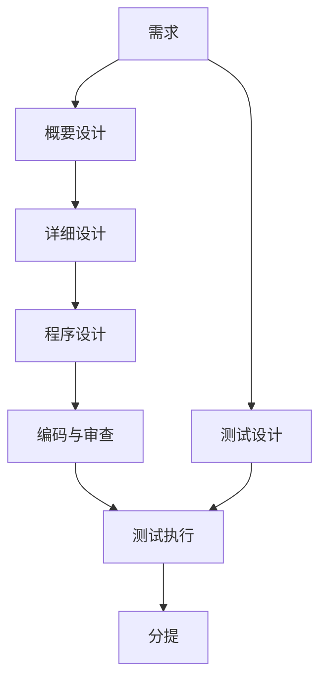

# 规格驱动与资产复用 流程设计

**日期**：2026-10-14  
**配套**：`specs/001-asset-reuse-harness/详细设计.md`  
**依据**：`ai-agent/rules/工程规约.md` 与各阶段技能。资产查阅的字段和四个方法以详细设计为准，本文不重复。

一次会话只做一个阶段。流水线技能根据 `ai-agent/spec/{需求项}/` 里已经有的文档和评估结论，只打开下一份允许进入的 `agent.md`。确认人未写入应用规约时向人索取。代理不得签署需求确认或架构师确认。

## 1. 总流程

需求确认通过之后，测试设计可以和后面的设计、编码并行。测试执行必须等编码评估通过。分提必须等 P0 有结果且失败项已关闭。

规格放在 `ai-agent/spec/{需求项}/`。关闭后迁入 `ai-agent/archive/YYMM/{需求项}/`。代码写在已点名且已检出的目标库；目标库未检出时才放 `work/{需求项}/{目标库}/`。业务代码不写进 `ai-agent/` 或 `docs/`。

子项编号以 5 开头。一个子项只对应一个概要模块、一个服务、一个目标工程。

## 2. 进入任何阶段之前

流水线技能做这几件事，本身不写用例、不写设计、不改代码：

1. 读 `ai-agent/rules/工程规约.md`。
2. 没有需求项编号时，只向人索取编号，然后停止。
3. 查看该需求项目录里已有文档和各阶段 `eval.md`。
4. 按下表确定下一阶段。阻塞设计的「待确认」未关闭时，停在提出该问题的阶段。确认栏还不是通过时，只请人签署，不问下一阶段。确认已经通过、人尚未同意进入时，只问一句：需求确认之后问概要设计还是测试设计，其余阶段问是否进入表中的那一个阶段。程序设计进入编码前，版本锁定仍须人已确认。人同意后才打开对应模板，并且这一轮只做该阶段。人在对话外改了确认栏时，要回到该需求再说继续，技能才会看到并提问。

| 当前事实 | 打开 |
|---|---|
| 没有通过的需求用例，或需求确认不是通过 | 需求 |
| 需求已确认，概要未通过 | 概要设计；测试设计可同时进行 |
| 概要自检已通过，架构师确认不是通过 | 停在架构师确认 |
| 概要已确认，详细未通过 | 详细设计 |
| 详细已通过，程序未通过；或详细的字段、状态、异常码、处理顺序已变而程序未重写 | 程序设计 |
| 程序设计已作废，或写明编码须停止 | 停在程序设计，不改代码 |
| 程序已通过，编码未通过 | 编码 |
| 编码已通过，P0 未执行完 | 测试执行 |
| P0 已完成且失败项已关闭 | 分提 |
| 已有用例上的缺陷，且范围、验收、优先级、受影响服务都没变 | 编码或测试，不重走概要设计 |

## 3. 需求

**进入**：有需求项编号。应用规约里没有的事实向人索取，不把空表当成事实。

**做什么**：

1. 读工程规约和需求应用规约。已经写明的术语、不可破规则、编号来源直接遵守。
2. 用来源记录这次输入。没有工单号就不编造。
3. 一次只问一个会让评估无法通过的缺口。人不纠正的，写入「待确认」，并标明是否阻塞设计。
4. 业务需求按用户目标拆用例。每条只有一个主成功目标，标 P0 或 P1。整份至少一条 P0。
5. 技术变更不编造角色和业务主流程。验收写行为如何保持，异常只写回退，该验收标 P0。
6. 用例之间、用例与范围外、用例与应用规约里已写明的规则，不能互相否定。
7. 同一需求项只保留一份用例。后一次修改在变更记录追加一行。

**资产**：不选定资产，不写组件标识，不写发布坐标，不调用 glue。

**留下**：需求用例。自检通过后，需求确认写成待确认，交给确认人。

**离开**：确认通过才允许概要设计和测试设计。确认人未写入应用规约时向人索取。代理不算确认人。

**打回**：范围、验收、优先级或受影响服务变了，且概要已经存在时，架构师确认改回待确认。不改这些内容的缺陷，不回头改概要设计。

## 4. 概要设计

**进入**：同一份需求用例里的需求确认是通过。仍阻塞设计的待确认未关闭时，退回需求。

**做什么**：

1. 沿用需求里已经写明的范围、验收、优先级、角色，以及 `docs/应用架构.md` 里已有的服务。不改写成另一套说法。
2. 按顺序判定变更类型，命中即停。
   - 技术变更：升级依赖、运行时或构建方式，不增加业务能力，不改变对外可见行为。写版本范围、行为是否变化、如何证明、如何回退。接口、能力地图、数据归属、业务补偿写「不适用」。
   - 结构变更：新增服务、新的系统间调用、同步或异步变化、数据归属变化，或升级改变了返回、错误、时序、默认配置。调用方向、数据归属、补偿责任写全。多个代码库本身不是结构变更。对外可见行为一旦会变，就不再按技术变更写。
   - 范围内改动：只改已有服务，沿用既有调用，数据归属不变。接口表写「沿用既有，无新增」。主流程里仍经过的既有跨服务调用要写失败与补偿。
3. 新服务指当前架构里还不存在的、对外可部署的服务，不是多出来的一个构建模块。新的系统间调用指现有架构里没有的调用方到被调方。
4. 用例里有多块可以分开验收的能力时，先列模块、落在哪个服务、依赖谁、对应哪些用例、构建顺序。依赖只指向一方。这张地图先按架构师确认规约确认，再写后面的章节。只有一块能力时写「能力地图不适用」。每条用例必须进入某个模块，或写入「本次不解决」。
5. 新服务、新的调用方向、同步还是异步、数据归谁，各写当前倾向、至少一个放弃的方案和放弃的原因。字段和类不在这里选。
6. 结构变更且服务不少于 2 个或接口不少于 2 条时，在接口表后加一段 Mermaid，只画调用方向，并与表一致。

**资产**：先有能力地图，再按可单独验收的一行写 `intent`。这样的一行才查阅一次。数据库写入若只是服务保存自己的数据，不单独成行。澄清文档写成独立能力的，例如发到 Kafka、证件号加密、生成业务流水号，才各成一行。不把整份文档合成一次查询，也不按实现时的每个技术点各查一次。这一行的一句话和标签只来自这一行对应的那一段；标签只取该段已经写明的词。

| intent | 本阶段做什么 |
|---|---|
| `add_capability`、`new_service_or_call`、`replace_capability` | 对该行调用一次 `search_components`。只记下标识、一句话能力、标签、状态 |
| `upgrade_existing` | 不按能力检索。组件标识来自代码库里已有依赖，留到程序设计点查 |
| `in_range_change` | 不查阅 |

新服务里只有一部分用到某项能力时，服务本身一行，该项能力另起一行。两行各自检索。某一行零命中，只让这一行沿原变更类型继续。

检索结果：恰好一条，记下标识并标「待详细设计绑定」；2 至 20 条，停住，一次只问一个问题；大于 20 条，只收窄标签后再查；零条，沿原变更类型继续，不编造资产。查阅不可用时，停该能力点并标成未验证。`in_range_change` 不得用来跳过这次失败。

本阶段不调用 `get_component`、`get_doc_section`、`get_sample`。不写完成方式，不锁版本，不摘文档正文。

**留下**：概要设计。自检清掉否决项后，交给架构师确认。编写者自己勾选通过不算确认。

**离开**：架构师确认通过后，下一步只打开详细设计。不写子项字段，不改目标库。

**打回**：用例太薄、无法判断落在哪个服务时，退回需求。详细设计需要改服务边界时，回到本阶段改概要，不在详细设计里改边界。

## 5. 详细设计

**进入**：需求确认和架构师确认都是通过。阻塞设计的待确认还在时，打回提出该问题的阶段。

**做什么**：

1. 按服务拆子项。一个子项只属于一个概要模块、一个服务。跨服务拆成两个子项，字段表归提供方。编号按详细设计应用规约取；没写明就问人，不编造。
2. 技术变更按目标代码库各写一份。契约各节写「不适用」，只保留该库的证明方式和回退。
3. 业务子项写字段、状态、重复提交的结果、处理步骤和异常码。没有状态或不会多写事实时，对应节写「不适用」。
4. 步骤有分支才加流程图。多个调用且调用方能看见中间失败才加时序图。不重画概要的调用方向，不画类和方法。
5. 需求里的 P0 要落到某个子项。放进「不包含」时写上承接的子项编号。
6. 服务、调用方向、数据归属和概要不一致时，打回概要设计。

**资产**：只处理概要已经记下的候选。

1. 用概要留下的标识调用 `search_components` 做点查。结果与概要矛盾则回到概要，不在这里改选。
2. 调用 `get_component`。未指定版本时只看身份和版本列表。人指定版本后，才看到该版本的发布标识、样例是否通过、章节标题。发布标识为空的版本不得留到程序设计去锁。
3. 人指定一章后，调用 `get_doc_section` 只读这一章。
4. 写成既有资产时，证据是读到的文档名称和章节，资产名来自该页。写成本服务实现时，对应查阅必须是零命中，证据写「无」。未查阅不得写成「无」。
5. 多种能力可以各绑一个资产。不得把多个候选的正文都拉下来再挑。

`upgrade_existing` 在本阶段仍不按能力检索。契约按技术变更或结构变更的原规则写，版本落在程序设计。

**留下**：详细设计。评估否决项清零后才交给程序设计。

**离开**：本阶段不写类和方法，不改代码。契约改了而程序设计已存在时，声明该程序设计作废，编码停止。

## 6. 程序设计

**进入**：详细设计评估已通过。其中阻塞程序设计的待确认还在时，停止。

**做什么**：

1. 读详细设计、工程规约和已经检出的目标库。
2. 每个子项定一个目标库、一个写入目录。映射不在程序设计应用规约里就问人，不自造库名。库未检出时写 `work/{需求项}/{目标库}/`，并标明分层尚未对照。
3. 技术变更只写版本、证明和回退。类和方法写「不适用」。
4. 业务子项写类或模块、方法级调用链、与异常码一致的失败返回。先列被依赖的方法，P0 行为放在编码顺序前面。
5. 应用规约里已经点名的公共方法必须复用。要改签名就停。一次资产选用不回写「必须复用」。
6. 日志和事务：应用规约没写时记「待对照」或「无」，不编造注解和字段。
7. 每个 P0 行为一行，写明先写的失败测试应证明什么。不写测试代码。

**资产**：

1. 调用 `get_component`，带上详细设计已经绑定的标识和人准备锁定的版本。
2. `upgrade_existing` 用代码库里已有的标识点查，不调用 `search_components`。该版本 `apiCompatibility` 为 `breaking` 时，再调用 `get_doc_section` 只读 `migrationDocChapter`。人看过迁移章之后才能确认。
3. 写下标识、版本、文档位置、样例标记、相对样例还要写的差异。版本写成显式版本，不写范围版本，不写 SNAPSHOT。样例标记必须等于该版本，且 `sampleTestsPassed` 为真，编码才允许取文件。发布标识为空则不得锁定。
4. 若父工程的版本管理会改掉这个显式版本，编码前停住问人。
5. 确认后不得自动换成更新的版本。公共用法变化则锁定作废并停止。仅内部变化且公共用法不变时，另开子项，目标改为资产所在工程。

**留下**：程序设计。评估通过后才交给编码。人确认锁定之前不得编码。

**离开**：本阶段不改 `git-repo-*` 或 `work/`。一个子项要改两个目标库时停止。失败返回在详细设计里没有对应异常码时停止。

## 7. 编码与审查

**进入**：程序设计评估已通过，没有作废或停止编码的标记。人已确认资产版本锁定。一次只取一个子项里的一片行为，P0 在前。

**做什么**：

1. 在程序设计点名的写入目录发现验证命令。优先用编码应用规约已写的命令，其次用该目录的构建文件。发现不了就停止，不套用别的库的命令。
2. 业务行为先写失败测试，再写刚好让它通过的实现和失败路径。有行为的类使用同一个测试类。本次改动的每个对外方法都有成功和失败的测试方法。异常码用详细设计已有的码。
3. 再跑这一测试，确认通过。然后跑该目录的全量测试和编译。先失败和后通过的命令结果写入该子项的编码记录。
4. 技术变更的验证表若只要求既有套件或构建仍通过：不新建业务测试类，跑点名的命令并记录结果。
5. 对照程序设计做代码审查，并并行做代码质量审查。两边的阻断项都清零，编码评估才能通过。
6. 交付前再做一次漂移分类。比较范围只包括该写入位置和依赖声明。未分类则不得把编码评估写成通过。

**资产**：

1. 按锁定章节调用 `get_doc_section`，只作对照。
2. 调用 `get_sample`。先取文件清单，再按路径取文件。只复制样例测试已经通过、且样例标记等于锁定版本的文件。只编写相对样例还要写的那部分。
3. 发布标识写进依赖声明，用现有仓库凭证取包。不使用 `GLUE_TOKEN` 取包。
4. 重写已经点名的资产，审查为阻断级。
5. 为了通过测试需要改需求、字段、异常码或公共方法签名时停止，退回对应阶段。

**留下**：写入目录里的代码和测试，以及该子项的编码记录。

**离开**：P0 没有先失败后通过的记录时，不得进入测试执行。技术变更改为：点名的既有套件或构建没有实际结果时，不得进入测试执行。单元测试通过不算验收通过。

## 8. 测试设计

**进入**：需求确认是通过。可以与概要、详细、程序、编码并行。编码未通过时，不得把本阶段写成测试完成。

**做什么**：

1. 从需求用例抄出每一条验收，保留用例编号和优先级。不改写业务规则，不把 P1 改成 P0。
2. 技术变更只抄「行为保持」和「回退」，不编造角色和业务主流程。
3. 填追溯表：验收项、用例、测试用例标识、优先级。每一条验收至少一行。每条 P0 都必须有测试用例标识。
4. 业务需求为 P0 补上可执行的主成功。权限、边界、失败、重复提交各自有用例。技术变更的 P0 是行为保持和回退。
5. 步骤写到角色、入口、关键数据和可判定期望。类名、方法名和单元测试类名不写入验收。
6. 追溯表有空行，或某条 P0 没有用例标识：停止。缺的是需求原文就打回需求，不自己补一条业务规则。

**资产**：不调用 glue。资产内部测试不写入本服务的验收。本服务仍要有资产成功和资产失败两条验收，它们来自需求里已经写明的验收，不来自组件手册。

**留下**：测试设计。通过只表示用例可执行，不表示测试完成。

## 9. 测试执行

**进入**：编码评估已通过，且测试设计里的 P0 用例可以执行。

**做什么**：

1. 按测试应用规约里已经写明的环境、账号和清理方式执行。没写的向人索取，不编造。
2. 执行每条 P0，记下结果。失败项关闭之前不得分提。
3. 不改范围、验收、优先级和受影响服务的缺陷，退回编码：先写能复现的失败测试，再改程序设计点名的目录。
4. 这些内容一旦变更，需求确认和架构师确认都回到待确认，已有测试通过作废。

**资产**：不调用 glue。不把组件自己的测试结果写成本服务的 P0 通过。

**留下**：测试执行记录。每条 P0 有结果。

## 10. 分提

**进入**：测试执行的结论是完成，且可以分提。每个 P0 有结果，失败项已关闭。

**做什么**：

1. 按程序设计的去向，每个目标库单独处理。一个目标库一次提交，不把多个库的文件打进同一次提交。
2. 代码已经在目标库检出里：在该检出上新建分支，分支名包含需求项编号，推到这个库自己的远程。
3. 代码在 `work/{需求项}/{目标库}/`：把文件放到目标库的原有路径后再提交。分提成功后删除这份副本。目标库检出保留。
4. 提交说明写明需求项编号、子项编号，以及验证已完成。不强制推送，不跳过该库已有的检查。
5. 目标库的检查失败时，回到原来的写入目录修改，重新走编码审查和失败用例。
6. 每个目标库都提交成功后，在该需求的规格目录记下目标库、分支和提交标识。
7. 需求关闭时，把 `ai-agent/spec/{需求项}/` 迁入 `ai-agent/archive/YYMM/{需求项}/`。

`ai-agent/`、`docs/` 和其他需求的 `work/` 留在规格库，不进入业务代码库。未列入本次需求的其他目标库改动不一并提交。

**资产**：不调用 glue。提交的依赖声明必须仍是程序设计锁定的那个显式版本。

## 11. 继续编码前的漂移

这不是单独阶段。准备在已有改动上继续编码，或准备把编码评估写成通过时，先由人分类。代理不得代为分类。

| 人确认的类别 | 流程去向 |
|---|---|
| 仅代码偏离 | 留在编码改代码，规格不变 |
| 方法、目标工程或资产版本变化 | 程序设计作废，编码停止 |
| 字段、状态、错误码或步骤顺序变化 | 回到详细设计，程序设计作废 |
| 范围、验收、优先级或受影响服务变化 | 需求确认和架构师确认作废，已有测试通过作废，回到需求 |
| 公共用法被破坏 | 按结构变更回到概要设计 |
| 无法判断 | 停止，只问一个问题 |

未分类时，继续编码的次数为 0。
