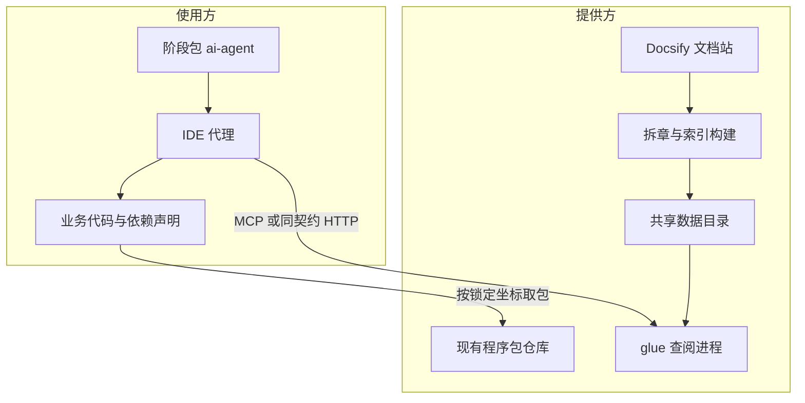
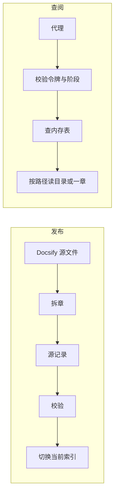

# 规格驱动与资产复用 详细设计（最终版）

**日期**：2026-10-14  
**章程**：`.specify/memory/constitution.md` 1.0.0。本文第 4 节把「只在新服务或新的系统间调用时检索」改为按意图检索，除此以外仍以章程为准。  
**规格**：`specs/001-asset-reuse-harness/spec.md`  
**状态**：最终版详细设计。阶段包正文已按本文写入 `ai-agent/`。glue 进程尚未实现。

本文单独可读。目录地址、文档宿主、样例库、第一个资产、查阅地址、确认人、仓库名没有事实，全文保持空白。`panda-test`、`https://123.12.1.21`、`com.example.internal` 只是旧材料里的格式示例，不得写成真实地址。

本文吸收了 `docs/胶水编程-全量更优设计.md` 里已经说清楚的部分：意图分类、索引校验后切换、升级时按已知标识点查、样例通过标记只由样例流水线写入、查阅令牌与拉包凭证分开、使用方仓库不放索引。不采用使用方合并或构建流水线门禁，不写未提供的网关、身份系统和恢复时限，不把组件级 `active` 定义成「坐标、拆章、样例全绿三者齐备」。

## 1. 总体架构

使用方只常驻阶段包。提供方托管文档站、程序包仓库和查阅进程。代理经 MCP 调用查阅；四个方法的 JSON 与 HTTP POST 的 body 相同。程序包不经过查阅进程。



| 界 | 负责 | 不负责 |
|---|---|---|
| 提供方 | 给人看的文档站、按章存放的正文、检索索引、样例发布快照、glue 进程、令牌、审计 | 替业务写代码；把文档、样例或索引放进使用方仓库 |
| 使用方 | 安装阶段包、按八个阶段写规格和锁定、编写资产未覆盖的部分 | 维护第二套规则目录；在仓库里放一份索引当作发现面 |
| 代理 | 按意图在允许的阶段调用四个方法 | 签署确认；自行在多条命中里挑选；查阅失败时编造资产 |

数据分两条，互不代替：



给人看的页面仍由 Docsify 部署。glue 不做成 Docsify 插件，代理不抓取文档站页面。Docsify 与 glue 分开放。索引和正文在共享的数据目录 `{root}`，glue 进程里不保存唯一副本，因此可以再加实例。实例个数由提供方决定，本文不指定产品和台数。

## 2. 阶段包

公司现有安装入口只把文件放到使用方工程的 `ai-agent/`。规则正文以这些文件为准。不另写一套常驻规则，不要求使用方的合并或构建流水线增加核对步骤。

首次放入：

- `ai-agent/rules/工程规约.md`
- `ai-agent/mcp/glue.md`
- `ai-agent/agents/README.md`
- 各阶段公共规约、概要设计的架构师确认规约、各阶段模板
- `ai-agent/skills/**/skill.md`（不含代码质量技能下的 `archive/`）
- 六份应用规约

再次放入：六份应用规约若已存在则跳过。其余文件写回发布版本。不得整目录删掉 `ai-agent/` 再拷贝。建议不改公共规约，不禁止修改。改过的副本不再是提供方发布版本。

不得放入阶段包：组件程序包、文档正文、样例、glue 进程、目录索引、令牌、本仓库的 `specs/`、`.specify/`、`.archify/`、交接说明，以及使用方 IDE 的整份配置。

使用方在自己的 IDE 配置里增加服务名 `glue`。地址空白，直到人提供。令牌只放环境变量 `GLUE_TOKEN`。Maven 拉包用现有仓库凭证，与 `GLUE_TOKEN` 分开。阶段包只写这两个凭证的变量名，不写实值。

实现时不新增技能。句子写进已有文件：

| 文件 | 写入 |
|---|---|
| `ai-agent/rules/工程规约.md` | 意图、四种查阅结果、变更类型、漂移、查阅不可用时停该能力点 |
| 需求技能 | 需求不选定资产，不写组件标识和发布坐标 |
| 概要设计技能 | 先写意图；该检索的意图必须先查阅 |
| 详细设计技能 | 完成方式、证据、与概要矛盾时返回 |
| 程序设计技能 | 版本锁定；升级点查；一次命中不回写「必须复用」 |
| 测试驱动技能 | 只复制已锁定且样例测试通过的文件；验证资产成功和失败 |
| 代码评审技能 | 重写已点名资产为阻断级；交付前再做漂移分类 |
| 阶段流水技能 | 一次会话一个阶段；继续编码前先分类漂移 |
| `ai-agent/mcp/glue.md` | 四个方法；MCP 与 HTTP 的 body 相同 |
| 六份应用规约 | 每个待填字段的四项说明；事实栏保持空白 |

六份应用规约的每个待填字段都写四件事：填什么、只填已经存在的事实、留空时哪一阶段问人、哪一阶段读取。

| 文件 | 已有事实栏 | 读取阶段 |
|---|---|---|
| 需求应用规约 | 领域术语、存量系统约束、角色与权限、编号与来源、需求确认人、合规与数据 | 需求 |
| 概要设计应用规约 | 架构师确认人；服务名以 `docs/应用架构.md` 已有内容为准 | 概要设计 |
| 详细设计应用规约 | 子条目取号、对象与码表 | 详细设计 |
| 程序设计应用规约 | 目标库与工作目录、必须复用、日志事务异常 | 程序设计 |
| 编码应用规约 | 仓库映射、语言与分层、日志与异常、数据访问、单元测试、验证命令 | 编码；表为空时改读程序设计 |
| 测试应用规约 | 环境、账号与权限、造数与清理、自动化、缺陷 | 测试设计与测试执行 |

## 3. 阶段与确认

阶段顺序不变：需求、概要设计、详细设计、程序设计、编码、测试设计、测试执行、分提。一次会话只做一个阶段。子项编号以 5 开头，一个子项只对应一个概要模块、一个服务、一个目标工程。代码写在已点名且已检出的目标库；目标库未检出时才放 `work/{需求项}/{目标库}/`。

变更类型仍按这个顺序判断，命中即停：技术变更、结构变更、范围内改动。多个代码库本身不是结构变更。进程内资产不是新服务，也不是系统间调用。判定沿用概要设计技能：

| 类型 | 怎样认定 |
|---|---|
| 技术变更 | 升级依赖、运行时或构建方式，不增加业务能力，不改变对外可见行为 |
| 结构变更 | 新增服务、新的系统间调用、同步或异步变化、数据归属变化，或升级改变了返回、错误、时序、默认配置 |
| 范围内改动 | 只改已有服务，沿用既有调用，数据归属不变 |

「新服务」和「新的系统间调用」对照当前已有架构，不看需求里有没有「新」字。新服务是当前应用架构中还不存在的、对外可部署的服务，不是多出来的一个构建模块。新的系统间调用是现有架构里没有的调用方到被调方。接口表写「沿用既有，无新增」就不是新调用。

代理不得签署需求确认或架构师确认。确认只打开下一设计阶段，不打开编码。

## 4. 意图：什么时候检索

每个子项在进入概要设计的资产步骤前写下 `intent`。未写不得查阅。

| intent | 含义 | 查阅 |
|---|---|---|
| `add_capability` | 要增加一种能力，包含进程内复用 | 必须 `search_components` |
| `new_service_or_call` | 要写新服务或新的系统间调用 | 必须 `search_components` |
| `replace_capability` | 换成另一个资产 | 必须 `search_components`，并确认迁移目标 |
| `upgrade_existing` | 升级代码库里已经在用的组件 | 不按能力检索。用已知标识 `get_component`。若该版本标明不兼容，再读迁移章，由人确认 |
| `in_range_change` | 沿用既有实现，不引入、不替换、不升级资产 | 不查阅 |

一次抬高多个已在用组件的版本，由人列出清单，每一项按 `upgrade_existing`。不另做坐标比对服务。

检索单位是能力地图上可单独验收的一行，不是整份文档，也不是实现时会碰到的每个技术点。数据库写入若只是这个服务保存自己的数据，留在服务那一行里，不单独检索。澄清文档把某一项写成独立能力时，例如把事件发到 Kafka、对证件号加密、生成业务流水号，才另起一行，各写各的一句话和标签，各调用一次 `search_components`。标签只取这一行正文里已经写明的词。标签之间是交集，整份文档合成一次查询会把局部能力稀释掉，或因为多出来的标签交成空集。

新服务里只有一部分用到某项能力时，服务本身是一行 `new_service_or_call`，那一项能力另起一行 `add_capability`。两行各自检索，互不取消。某一行零命中，只表示这一行沿原变更类型继续。

`in_range_change` 不得用来跳过一次本该查阅却失败的能力点。令牌缺失、地址空白、调用失败或索引未就绪时：`add_capability`、`new_service_or_call`、`replace_capability` 和需要读登记的 `upgrade_existing` 停住该能力点，并标成未验证；真正无关的 `in_range_change` 可以继续。不得猜接口，不得改用仓库里的过期文档。

技术变更里「只升级已有组件且对外行为不变」对应 `upgrade_existing`。升级若改变了返回、错误、时序或默认配置，变更类型改为结构变更，意图仍是 `upgrade_existing`，不因此换成另一个组件。只有同时还要新增能力、替换资产，或新写服务、新的系统间调用时，才把意图改成对应的必须检索项。

### 4.1 阶段与方法

服务按 `callerStage` 拒绝不允许的方法。

| 阶段 | search | get_component | get_doc_section | get_sample |
|---|---|---|---|---|
| 需求 | 否 | 否 | 否 | 否 |
| 概要设计 | 仅三个必须检索的意图 | 否 | 否 | 否 |
| 详细设计 | 带概要留下的标识做点查 | 是 | 人指定一章 | 否 |
| 程序设计 | 否 | 是 | 仅升级时的迁移章 | 否 |
| 编码 | 否 | 否 | 按锁定章节 | 是 |
| 测试设计、测试执行、分提 | 否 | 否 | 否 | 否 |

概要设计的检索结果只有标识、一句话能力、标签、状态。不写完成方式，不锁版本，不摘正文。

### 4.2 检索的四种结果

`deprecated` 不算命中，除非本次需求写明保留该旧资产。`yanked` 不进检索。

| 命中 | 处理 |
|---|---|
| 恰好 1 条 | 只记下标识，标记「待详细设计绑定」 |
| 2 至 20 条 | 停住，一次只问一个问题。代理不得自行挑选 |
| 大于 20 条 | 只返回命中数和标签分布，先收窄再查 |
| 0 条 | 沿原变更类型继续，不编造资产 |
| 查阅不可用 | 停该能力点，标成未验证。见第 4 节 |

「必须复用」清单优先于检索排序。冲突时停住问人。一次选用只写在该子项的程序设计里，不回写应用规约。把它升成以后每次必须复用，是另一次治理修改。

### 4.3 完成方式与版本锁定

详细设计只在概要已经记录的那个标识上决定。与概要矛盾则回到概要。多种能力可以各绑一个资产。不得把多个候选的正文都拉来再挑。

| 完成方式 | 证据 | 条件 |
|---|---|---|
| 既有资产 | 文档名称和章节；资产名来自读到的那一页 | 概要已有候选，且读到的页面与候选一致 |
| 本服务实现 | 无 | 该能力的查阅确实是零命中 |

未查阅不得写成「无」。

程序设计记下：资产标识、人确认的版本、该版本的文档位置、样例标记、相对样例还要写的差异。人确认前不得编码。确认后不得自动换成更新的版本。依赖声明写这个显式版本，不写范围版本，不写 SNAPSHOT。若父工程的版本管理会改掉这个显式版本，编码前停住问人。

`upgrade_existing` 同样锁定人确认的版本。该版本标明不兼容时，必须读到迁移章后才能确认。公共用法变化则锁定作废并停止。仅内部变化且公共用法不变时，另开子项，目标改为资产所在工程。

编码只复制样例自身测试已经通过、且样例标记等于锁定版本的那些文件，并加入该版本的发布标识。重写已经点名的资产，代码评审为阻断级。测试验证本服务在资产成功和资产失败时的行为。资产内部测试不算本服务通过。

### 4.4 漂移

规格保持事实来源。不得按代码差异回写规格，不得另建同步轨迹。已命名写入位置已有改动时，继续编码前由人确认类别。交付前再分类一次。比较范围只包括该写入位置和依赖声明。漂移确认不是需求确认，也不是架构师确认。未分类时，继续编码的次数为 0。

| 类别 | 去向 |
|---|---|
| 仅代码偏离 | 改代码，规格不变 |
| 方法、目标工程或资产版本变化 | 程序设计作废，编码停止 |
| 字段、状态、错误码或步骤顺序变化 | 先回详细设计，程序设计作废 |
| 范围、验收、优先级或受影响服务变化 | 需求确认和架构师确认都作废，已有测试通过作废 |
| 公共用法被破坏 | 按结构变更回到概要设计 |
| 无法判断 | 停止，只问一个问题 |

## 5. glue 的四个方法

```text
IDE 代理
  → MCP（或 HTTP POST），令牌来自 GLUE_TOKEN
  → 校验令牌与 callerStage
  → 查内存表，或按路径读一个文件
  → 追加一条审计
  → 返回 JSON
```

令牌放在 `Authorization: Bearer`，不进 body，不进仓库。`callerStage` 取第 4.1 节的阶段名。HTTP 路径为 `POST /search_components`、`POST /get_component`、`POST /get_doc_section`、`POST /get_sample`。路径不是已发布地址。请求和成功响应带 `glueProtocolVersion`，本期为 `1`。阶段包声明它接受的版本；对不上则停止查阅并询问。

失败：

```yaml
ok: false
code: ""
message: ""
glueProtocolVersion: 1
```

`code` 为 `missing_token`、`forbidden_stage`、`not_found`、`empty_query`、`missing_version`、`missing_chapter`、`too_large`、`sample_not_passed`、`hash_mismatch`、`yanked`、`protocol_mismatch`、`index_not_ready` 之一。

审计在提供方追加一行：时间、身份、动作、资产标识、版本、允许或拒绝、原因、`callerStage`。不进阶段包，不参与检索。

### 5.1 search_components

允许阶段：概要设计、详细设计。详细设计带上概要留下的标识时，只做主键点查。

入参：`callerStage`、`id`、`summary`、`tags`、`includeDeprecated`（默认 false）、`glueProtocolVersion`。

出参只有 `id`、`summary`、`tags`、`status`，另有 `matchCount`。命中大于 20 时 `matches` 为空，改为 `tagFacets`。不含发布标识，不含正文。

### 5.2 get_component

允许阶段：详细设计、程序设计。`id` 必填。`version` 可空。服务不挑选较新版本。`yanked` 拒绝。

无版本：返回身份和版本号列表，每项带 `sampleTestsPassed` 和该版本是否标明不兼容。有版本：再返回该版本的 `gav`、`docKeyTemplate`、`sampleTag`、`sampleTestsPassed`、不兼容标记、迁移章标识，以及按顺序排列的 `chapter` 和 `title`。不返回 `objectKey` 和正文。`gav` 为空的版本可以出现在列表里，程序设计不得把它锁成编码依赖。

### 5.3 get_doc_section

允许阶段：详细设计、编码；程序设计仅能读取该版本标明的迁移章。`id`、`version`、`chapter` 都必填。缺版本、缺章节、或要求整份文档，都拒绝。单章大于 262144 字节拒绝。

出参：`chapter`、`title`、`byteSize`、`contentHash`、`content`。`content` 是这一章的纯文本。

### 5.4 get_sample

允许阶段：编码，且程序设计已锁定版本、人已确认。`id`、`version` 必填。`path` 空则只返回文件清单；有 `path` 再读那一个文件。

`sampleTestsPassed` 为假，或 `sampleTag` 不等于 `version`，则拒绝。一次返回的正文合计超过 1048576 字节则停止，其余文件留下次按 `path` 再取。文件来自 `{root}/objects/references/{id}-ref/{version}/`。使用方不把样例仓库当作默认可抄来源。

## 6. 数据存在哪里

```text
{root}/
  catalog/
    source/{id}/
      identity.yaml
      versions/{version}.yaml
      versions/{version}.chapters.yaml
      versions/{version}.samples.yaml
    built/
      search-index.yaml
      current
  objects/
    {id}/{version}/chapters/{chapter}
    references/{id}-ref/{version}/{path}
  audit/{yyyy}/{mm}/{dd}.jsonl
```

`{root}` 由提供方配置，本仓库空白。`current` 指向正在使用的那一份索引。程序包不放进 `{root}`。

发布时从 Docsify 的源文件生成这些记录，与该次提交相同。不通过访问文档站页面来拆章。一个组件一页，对应一条身份。二级标题各成一章。功能简述压成不超过 80 字的 `summary`。版本说明表里的每个版本各留一份版本记录。使用说明里的发布坐标写入该版本的 `gav`，没有事实则空着。

拆章只保留文字。图片不进入 `objects/`。图所表达的规则必须在同一章里用文字写出，否则这一章不得作为完成方式的证据。Docsify 页面上的图保持原样。

`id`、`version`、`chapter` 只允许字母、数字、点、下划线和连字符。中文放在 `summary`、`title`、`tags`。`id` 发布后不改。

## 7. 数据结构

### 7.1 身份 `identity.yaml`

主键 `id`，与目录名相同。

| 字段 | 约束 |
|---|---|
| `summary` | 一句话能力，1 至 80 字。倒排只切这一句 |
| `tags` | 人填，每项 1 至 32 字，不重复 |
| `maintainer` | 可空 |
| `status` | `active`、`experimental`、`deprecated`、`yanked` |

`status` 描述这条身份现在能不能被推荐，不代替下面的版本记录。`active` 和 `experimental` 进入检索。`deprecated` 默认不进入。`yanked` 表示紧急下架：立即离开检索，`get_component` 和 `get_sample` 拒绝，已经锁定该标识的编码停住并询问。

### 7.2 版本 `{version}.yaml`

主键 `id` + `version`。同一组件多版本并存。服务不按版本号大小选择记录。

| 字段 | 约束 |
|---|---|
| `gav` | 该版本发布标识。无事实则空。空则不得锁成编码依赖 |
| `sampleTag` | 样例测试通过时等于 `version`，否则空 |
| `sampleTestsPassed` | 仅样例流水线在测试通过并上传快照后写入 |
| `docKeyTemplate` | `{root}/{id}/{version}/chapters/{chapter}` |
| `apiCompatibility` | `compatible` 或 `breaking`。默认 `compatible` |
| `migrationDocChapter` | `breaking` 时必填，指向迁移章 |
| `indexed` | 该版本是否已进入当前索引 |

样例测试未通过，不影响该版本被检索和被 `get_doc_section` 读取。它只拒绝 `get_sample`。

### 7.3 章节目录与样例目录

`{version}.chapters.yaml` 一行一章，没有正文。字段：`chapter`、`title`、`ordinal`、`byteSize`、`contentHash`、`objectKey`。`objectKey` 为 `{id}/{version}/chapters/{chapter}`。`byteSize` 大于 262144 不得发布。`contentHash` 为空不得进入当前索引。

`{version}.samples.yaml` 一行一个文件，没有文件内容。`path` 不含 `..`。`objectKey` 为 `references/{id}-ref/{version}/{path}`。没有通过测试的样例则不要这份文件。

### 7.4 发布索引

`search-index.yaml` 由全部可检索的源记录生成。`components` 存身份加版本摘要。三张倒排：`postings.tag`、`postings.token`、`postings.deprecatedTag`。`ids` 按字典序、不重复。章节目录和正文不复制进这份文件。

切词只用于 `summary` 和查询句：去首尾空白；连续英文和数字成词并小写，长度小于 2 丢掉；连续汉字每相邻两字成词；标点只用来断开。

构建写到临时对象，解析通过并且每章 `contentHash` 都非空之后，才改 `current`。失败则不切换，查阅继续用上一份。同一次发布里，同一 `id` 的构建串行完成后再切换。

### 7.5 内存

进程用 Java。启动时按 `current` 读入一份不可修改的快照。一次请求开始时把引用读到局部变量，全程用这一份。

| 表 | 键 | 值 |
|---|---|---|
| `byId` | `id` | 身份记录（含版本摘要） |
| `byVersion` | `id` + `version` | 该版本的发布标识、样例标记、是否通过、是否不兼容 |
| `byTag` | `tag` | `id` 列表 |
| `byToken` | 词 | `id` 列表 |
| `byDeprecatedTag` | `tag` | `id` 列表 |

章节标题和正文不在这些表里。索引切换时丢掉章节目录缓存。缓存最多 256 条解析后的目录，不缓存正文。

## 8. 进程内部怎么读

| 方法 | 内存 | 文件 |
|---|---|---|
| `search_components` | 只查 HashMap | 不读 |
| `get_component` 无版本 | 只查 `byId` | 不读 |
| `get_component` 有版本 | `byId`、`byVersion` | 读 `{version}.chapters.yaml` |
| `get_doc_section` | 不查倒排 | 先读章节目录，再读章正文 |
| `get_sample` 无 `path` | `byVersion` | 读 `{version}.samples.yaml` |
| `get_sample` 有 `path` | 同上 | 再读那一个样例文件 |

读文件用 `java.nio.file.Files`。`id`、`version`、`chapter` 先做字符校验，`normalize` 之后必须落在 `catalog/source` 或 `objects` 下面。章节目录用 SnakeYAML 解析，大于 1 MiB 则拒绝。章正文先看 `Files.size`，超过 262144 或与 `byteSize` 不符则不读进内存；读入后字节数和 `contentHash` 必须对上。

检索只在 HashMap 上：

1. `id` 非空则只查 `byId`。
2. `summary` 和 `tags` 都空则拒绝。
3. 标签取交集；查询词取并集；两边都有则再相交。只有查询词时，保留至少命中一半词的标识，一半向上取整。
4. 去掉未允许的 `deprecated` 和全部 `yanked`。
5. 按命中词数从多到少，相同则按 `id` 字典序。再按第 4.2 节截断。

## 9. 还没填的事实

查阅地址、`{root}`、实例个数、第一批组件的真实 `id` 和 `gav`、确认人、使用方仓库名。这些保持空白，到对应阶段问人。

阶段包句子已写入 `ai-agent/`。glue 进程的编码不在本文范围内。字段级样例仍见同目录的专项文件；若与本文冲突，以本文为准。

## 10. 专项文件

| 文件 | 内容 |
|---|---|
| `contracts/stage-package.md` | 阶段包文件清单 |
| `contracts/glue-lookup.md` | 四个方法的阶段限制 |
| `contracts/catalog-index.md` | 字段表与检索步骤 |
| `glue-implementation.md` | 入参出参 |
| `glue-runtime.md` | HashMap 与文件读取 |
| `glue-example-readme.md` | 一份文档如何拆章（格式示例，不是已登记资产） |
| `data-model.md` | 候选绑定、完成方式、版本锁定、漂移 |
| `流程设计.md` | 八个阶段各自做什么、留下什么、何时查阅 |

总体架构以本文第 1 节的 Mermaid 为准。`.archify/` 里已有的图作为下钻，后一步再按本文美化。
